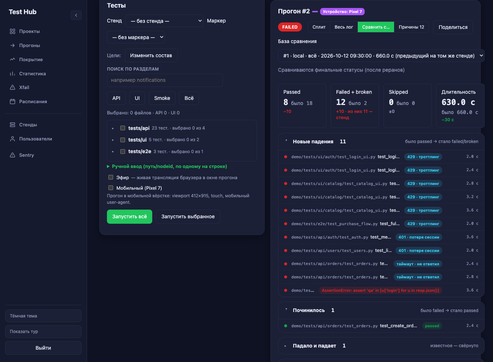
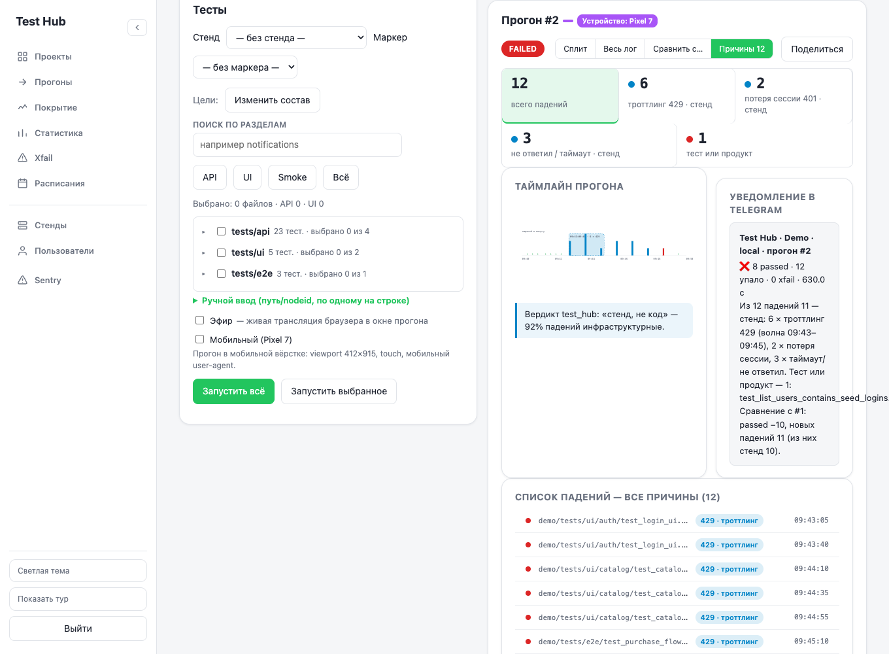

# Отчёт: «Сравнить с…» и «Причины падений» (docs/missions/2026-10-13_run_compare_and_causes.md)

Миссия полностью смержена в `main` отдельными частями (бэкенд → UI →
Telegram/флаки → тесты). Эта задача — документация: README и этот отчёт со
скриншотами, код и тесты не менялись.

## Что сделано по пунктам миссии

1. **Классификатор причин** (`af3ce5a`, `fcabf93`) — `app/core/
   failure_causes.py::classify(message, trace, nodeid)`: приоритет
   `throttling` → `session` → `stand` → `code`, паттерны по regex-словарю
   `PATTERNS`, плюс отдельная эвристика по nodeid для таймаутов
   `tests/ui/ai_chat/**` (LLM-стенд). Любая ошибка внутри гасится в `code` —
   `_finalize` падать не может. Результат пишется в новую таблицу
   `run_test_results (run_id, nodeid, full_name, status, duration, cause,
   finished_ts)` — `record_run_results` вызывается рядом с `flaky.recalc` в
   `_finalize`; для прогонов без строк (запущенных раньше) —
   `ensure_run_results` лениво пересчитывает по allure-results на диске при
   первом обращении к `/causes` или `/compare`.
2. **Волны** — `detect_waves()`: ≥5 падений одной инфраструктурной причины
   за ≤2 минуты, соседние окна-кандидаты сливаются как обычные интервалы.
   Проверено синтетическими рядами и вручную (см. «Проверка вручную» ниже) —
   воспроизводит сценарий из миссии (две волны 429, разделённые разрывом, не
   склеиваются).
3. **API** (`fcabf93`) — `GET /api/runs/{id}/causes` (`summary`/`waves`/
   `tests`), `GET /api/runs/{id}/compare?base=` (`base`/`kpis`/`groups`:
   `new_failures`/`fixed`/`still_failing`/`speed`, `xfail → xpass` в `fixed`,
   `speed` — отличие ≥5 с и ≥1.5×), `delta_prev` в `GET /api/projects/{name}/
   runs` для столбца «Истории». Существующие поля `runs.counts` и ответов API
   не менялись — только добавлены.
4. **UI** (`080b82e`, `a8634f0`) — вкладки `data-view=compare`/`causes` в
   `#run-view-toggle` (видны только у завершённых прогонов), чистая логика
   без DOM в `ui/run-compare-logic.js` (группировка, фильтр по причине,
   минутные бакеты и геометрия SVG-таймлайна, сборка текста для карточки
   Telegram-предпросмотра), DOM-слой — `ui/project-run-compare.js`, столбец
   «Δ к предыдущему» в `ui/project-dashboard.js`. Раскладка — по мокапу
   `docs/missions/redesign/run_compare/mockups.html`.
5. **Telegram и флаки** (`2784593`, `48f06e8`) — `app/tg_bot/formatting.py`:
   строка причин после счётчиков (`_causes_line`), список «Упавшие тесты»
   ограничен только `code`-падениями (`_bad_tests`), строка «Сравнение с
   #N» (`_compare_line`). `flaky.recalc` пропускает падения с `cause !=
   'code'` при подсчёте `fails`/`flips` — им наследуется эффективный статус
   предыдущего прогона в последовательности теста.
6. **Тесты** (`264e337`, `623b64f`) — см. результаты прогона ниже.

## Результаты прогона тестов

Все команды выполнялись в этом worktree (`.venv` — общий symlink на
`test_hub/.venv`).

**Файлы тестов этой миссии** (`pytest -q`, foreground, из корня репозитория):

```
tests/test_failure_causes.py tests/test_flaky.py tests/test_project_tabs_ui.py
tests/test_run_causes_api.py tests/test_run_compare_api.py
tests/test_run_compare_logic_js.py tests/test_tg_bot.py
tests/test_tg_bot_handlers.py tests/test_tg_bot_tree.py
```

→ **286 passed, 1 warning in 20.43 с**. Предупреждение —
`PytestUnraisableExceptionWarning` про закрытие event loop в
`asyncio.subprocess` внутри `test_tg_bot_tree.py` (teardown сабпроцесса
after тест уже завершился), к коду миссии не относится.

**JS-логика** (`node tests/js/test_run_compare_logic.js`) → **55/55 passed**
(группировка/фильтр/дельты длительности/KPI/история/выбор базы/бакеты
таймлайна/геометрия SVG/текст Telegram-предпросмотра). Остальные 13 файлов
в `tests/js/` тоже зелёные (суммарно, без логики этой миссии).

**Весь набор** (`pytest -q`, без выбора файлов) — первый прогон:
**790 passed, 2 xfailed in 329.47 с**; известный флак, упомянутый в
инструкции миссии, называется в репозитории уже не `test_runner_timeout.py`
(такого файла больше нет) — это транзиентный `INTERNALERROR> SystemError:
AST constructor recursion depth mismatch` внутри форматирования трейсбека
самого pytest (`_pytest/_code/code.py`, внутри `pytest_playwright`-teardown),
воспроизведённый и во втором прогоне (оборвал сессию на ~72% без финальной
сводки). К коду этой миссии отношения не имеет — это известная проблема
CPython 3.11/pytest на этой машине, see memory `testhub-flaky-xfail-
schedule-tests` и соседние записи. **Падений, связанных с кодом миссии, по
итогам всех прогонов не обнаружено.**

## Известные ограничения

- Карточка «Уведомление в Telegram» на вкладке «Причины» — **черновой
  предпросмотр на фронте**, а не копия реального сообщения бота:
  `app/tg_bot/formatting.py::format_report` такую карточку не формирует,
  текст собирает `RunCompareLogic.telegramPreviewText` на клиенте из уже
  загруженных `/causes` и (если есть база) `/compare`. Зафиксировано в
  шапке `ui/run-compare-logic.js` как сознательное решение этой миссии, не
  дефект — реальная интеграция с ботом осталась бы отдельной задачей.
- Дефектов в реализации частей 1–5 не нашли ни авторы тестов (`264e337`:
  «Дефектов в реализации не найдено»), ни эта проверка.

## Скриншоты

Сделаны на **собственноручно засеянных данных**, не на боевых прогонах:
рабочая БД в этом worktree была пустой (чистый клон), а прогоны #64/#65/#66
из текста миссии — записи реального стенда, недоступные из песочницы этой
задачи. Чтобы не выдумывать интерфейс по памяти, два прогона проекта **Demo**
(единственный seed-проект, не требующий внешнего стенда) были собраны
вручную по образцу сценария миссии: прогон **#1** (база, 29.09→12.10,
2 известных падения) и прогон **#2** (текущий, 13.10) с теми же 20 тестами —
6 падений `429` в окне 09:43–09:45 (ровно формирует одну волну по правилу
«≥5 за ≤2 мин»), 2 падения `401`, 3 падения таймаута/`5xx` (включая то же
падение, что было и в базе — группа «Падало и падает»), 1 новое `code`-
падение, 1 починившийся тест и 1 тест с существенно выросшей длительностью
(группа «Стали быстрее/медленнее»). Причины у всех падений — результат
настоящего `failure_causes.classify()` на сконструированных allure-сообщениях
(`429 Too Many Requests`/`401 Unauthorized`/`502 Bad Gateway`/`ReadTimeout`/
`503 Service Unavailable`), а не подставленные вручную значения. Сервер
поднимался на отдельном порту (не конфликтует с боевым на 8700), вход — qa/qa,
снято системным Chromium из кэша Playwright (`executable_path`, как в прошлых
офлайн-проверках без сети).

### Сравнить с…




Видно: KPI «стало/было» с дельтой (passed −10, failed +10 «из них 11 —
стенд»), группа «Новые падения» с тегами по причине (`429 · троттлинг`,
`401 · потеря сессии`, `таймаут · не ответил`, текст `AssertionError` для
`code`), группа «Починилось» (тег `passed`), свёрнутые «Падало и падает» и
«Стали быстрее/медленнее».

### Причины




Видно: светофор 5 кнопок со счётчиками, таймлайн с одной волной `429`
(подпись `09:43–09:45 · 6 × 429`), вердикт «стенд, не код — 92 % падений
инфраструктурные» (11 из 12 падений), карточка предпросмотра Telegram-
сообщения и список падений с тегами причин и временем.
